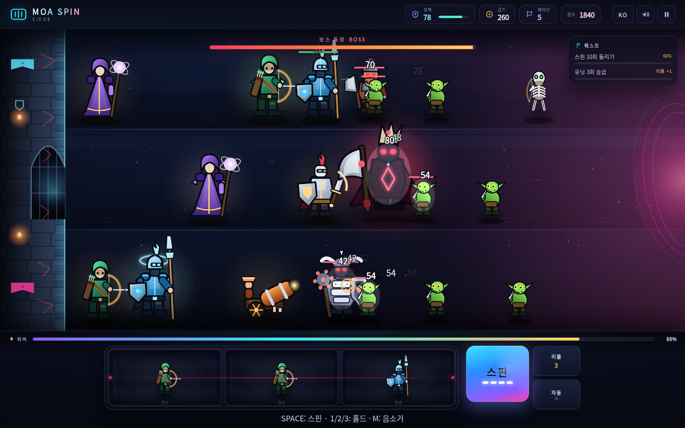

# MOA 스핀 시즈 (MOA Spin Siege)

슬롯머신으로 군단을 소환하는 **로그라이크 라인 디펜스** HTML5 게임입니다.
외부 CDN·이미지·폰트 없이 단일 폴더로 동작하며, `index.html`을 더블클릭하면 바로 실행됩니다.



---

## 바로 실행

```
slot-defense/index.html   ← 브라우저로 열기 (Chrome / Safari / Edge)
```

로컬 서버가 필요하면:

```bash
cd slot-defense
python3 -m http.server 8080
# http://localhost:8080
```

빌드 과정 없음, 설치 없음, 오프라인 동작. 모든 그래픽은 canvas 벡터로,
모든 사운드는 Web Audio로 런타임에 생성됩니다.

---

## 조작

| 동작 | 데스크톱 | 모바일 |
|---|---|---|
| 스핀 | `SPACE` / SPIN 버튼 | SPIN 버튼 |
| 릴 고정(홀드) | 릴 클릭 · `1` `2` `3` | 릴 탭 |
| 리롤 | `R` / REROLL 버튼 | REROLL 버튼 |
| 자동 스핀 | AUTO 버튼 | AUTO 버튼 |
| 일시정지 | `ESC` / `P` | ⏸ 버튼 |
| 음소거 | `M` | 🔊 버튼 |

---

## 게임 루프

1. **스핀 → 소환** — 릴 3개가 곧 3개의 라인입니다. 심볼이 나오면 해당 라인에 유닛이 소환됩니다.
   - 창병(근접) · 궁수(원거리) · 마법사(광역) · 포병(장거리 포격) · 기사(탱커) · 골드 · 유물
2. **매치** — 같은 심볼 2개는 보너스, 3개는 **잭팟**: 2단계 유닛 3기가 한 번에 쏟아지고 골드·피버가 붙습니다.
3. **승급(합체)** — 같은 라인에 같은 유닛이 다시 나오면 하나로 합쳐져 한 단계 위로 진화합니다.
   단계가 오를수록 스프라이트가 커지고 오라·날개가 붙으며, 3단계부터 다중 타격(관통·광역)이 붙습니다.
   라인이 가득 차면 새 유닛이 가장 약한 유닛에게 **흡수**되어 승급시킵니다.
4. **웨이브 방어** — 적은 오른쪽 포탈에서 성벽으로 진군합니다. 5웨이브마다 보스.
5. **유물 드래프트** — 웨이브를 클리어하면 유물 3개 중 1개를 선택합니다(리롤 40G).
   잭팟 확률, 관통 창, 쌍둥이 릴, 흡혈, 뇌격, 황금 손 등 16종 + VIP 전용 1종.
6. **피버** — 스핀·매치로 게이지가 차면 9초간 피버: 매치 확률 급증 + 스핀 충전 1.9배.
7. **퀘스트** — 스핀·승급·처치·잭팟 등 8종 미션이 자동으로 갱신되며 골드/리롤을 지급합니다.

성벽 HP가 0이 되면 런 종료. 최고 점수·최고 웨이브는 로컬에 저장됩니다.

---

## 지원 환경

| 항목 | 내용 |
|---|---|
| 해상도 | 데스크톱 1440×900 / 모바일 세로 390×844 (그 사이 전부 대응) |
| 언어 | 한국어 · English · 中文 · 日本語 (171키 × 4개 언어, 누락 0) |
| 사운드 | Web Audio 신디사이저 (스핀 틱, 릴 정지, 잭팟 팡파르, 타격, 승급, 피버, 보스) |
| 외부 의존성 | 없음 (CDN·폰트·이미지·라이브러리 0) |
| 저장 | localStorage (`moa.ss.best`, `moa.ss.bestWave`, `moa.ss.lang`, `moa.ss.muted`, `moa.ss.vip`) |

---

## VIP 스타터 팩 (선택)

무료 플레이를 막지 않는 선택형 상품입니다.

- 메뉴 → **VIP 팩 보기**: <https://www.latpeed.com/products/VTtxq>
- **체험 코드 `MOA-SLOT-2026`** 등록 시 전설 유물 **성검의 각성**(모든 유닛 공격력·체력 +35%, 황금 오라)과
  황금 스킨이 해금됩니다. 등록하지 않아도 모든 콘텐츠를 플레이할 수 있습니다.

---

## 파일 구조

```
slot-defense/
├─ index.html            화면 마크업 (HUD · 릴 · 오버레이)
├─ css/style.css         네온 판타지 UI, 반응형 레이아웃
├─ js/i18n.js            4개 언어 사전 + SB.I18n.check()
├─ js/audio.js           Web Audio 신디사이저 (샘플 없음)
├─ js/art.js             유닛·적·유물 아이콘 절차적 벡터 아트 (캐시)
├─ js/game.js            엔진: 스핀·소환·합체·전투·웨이브·유물·퀘스트·렌더
├─ test/verify.py        Playwright E2E 검증 (42개 체크)
├─ promo/                런칭 홍보 문구 (한·영·중·일, Threads / X)
└─ screenshots/          데스크톱·모바일·타이틀 스크린샷
```

---

## 검증

```bash
pip install playwright && playwright install chromium
python3 test/verify.py
```

검사 항목: 콘솔 에러 0, 가로 오버플로 0(데스크톱·모바일), 스핀→소환→전투→승급→웨이브 클리어→유물 드래프트,
4개 언어 전환(원문 키 노출 0), VIP 체험 코드, 보스 웨이브, 스크린샷 캡처.
결과는 `test/last-run.json`에 저장됩니다.

---

## 스크린샷

- `screenshots/slot-defense-desktop.png` (1440×900)
- `screenshots/slot-defense-mobile.png` (390×844)
- `screenshots/slot-defense-menu.png` (타이틀)

원본은 워크스페이스 `browser/` 폴더에도 있습니다.

---

## English summary

**MOA Spin Siege** is a slot-machine roguelike lane defense that runs entirely in the browser
with zero dependencies. Spin three reels to summon spearmen, archers, mages, artillery and knights
into three lanes; duplicate units on a lane merge into stronger tiers; clear a wave to draft one of
three relics; survive boss waves. Four languages (KO/EN/ZH/JA), responsive to desktop and mobile,
procedural vector art and a Web Audio synthesizer. Optional VIP starter pack (`MOA-SLOT-2026` trial
code) unlocks a legendary relic without affecting free play.
